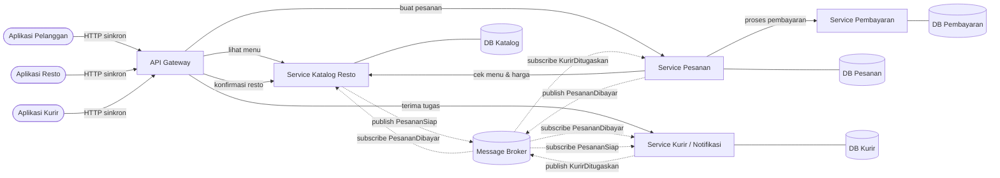
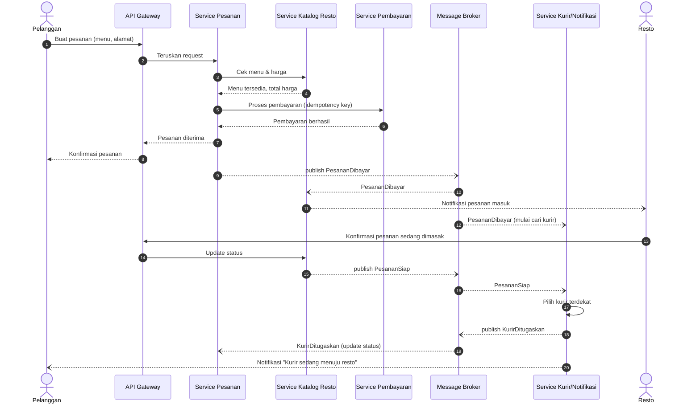

# Tugas 2 (Pekan 2) — Perancangan Arsitektur untuk FoodGo

**Materi terkait:** Architectural style (Layered, SOA, Peer-to-Peer, Publish-Subscribe).

## Studi Kasus

Melanjutkan Tugas 1: FoodGo butuh sistem yang **decoupled** agar tim kurir dan tim resto tidak saling mengganggu ketika salah satu modul diperbarui/deploy ulang. Saat ini semua modul (pesanan, pembayaran, notifikasi kurir, katalog resto) berjalan sebagai satu aplikasi monolitik — sekali deploy, semua modul ikut restart dan berisiko downtime total.

## Tugas Kelompok

1. Pilih **satu** gaya arsitektur utama: **Service-Oriented Architecture (SOA)** atau **Publish-Subscribe**. Boleh dikombinasikan (mis. SOA untuk service inti + Pub-Sub untuk notifikasi), tapi harus dijustifikasi kenapa kombinasi ini yang dipilih.
2. Gambarkan minimal 4 komponen berikut dan interaksinya: modul Pesanan, modul Pembayaran, modul Kurir/Notifikasi, modul Katalog Resto (dan message broker/API gateway jika relevan).
3. Jelaskan alur satu skenario penuh secara end-to-end di diagram (misalnya: pelanggan buat pesanan → bayar → resto terima notifikasi → kurir ditugaskan) — tunjukkan komponen mana berkomunikasi dengan siapa, dan **jenis komunikasinya** (sinkron/asinkron, request-response/event).
4. Analisis tertulis: kenapa gaya ini mengatasi masalah *coupling* dari Tugas 1, dan apa trade-off-nya (mis. Pub-Sub menambah kompleksitas debugging karena alur tidak linear).

**Kelompok:** Kelompok 5
 
| Nama | NIM | Kontribusi |
|---|---|---|
| Gusti Rifan | 103072400150 | Pemilihan dan analisis arsitektur SOA + Publish-Subscribe |
| Gde Andika Ananta Putra | 103072400161 | Komponen dan diagram arsitektur |
| Dyandra Alifyan Nugroho | 103072400014 | Skenario end-to-end dan alur komunikasi |
| Muhammad Rajwa Al Fathan Koessaputra | 103072400113 | Analisis coupling, trade-off, dan kesimpulan |
 
---
 
## 1. Gaya Arsitektur yang Dipilih
 
Kami memilih **kombinasi SOA dan Publish-Subscribe**:
 
- **SOA untuk service inti.** Pesanan, Pembayaran, dan Katalog Resto menjadi service terpisah yang masing-masing punya database sendiri dan diakses lewat API. Komunikasinya **sinkron (request-response)** karena pelanggan butuh jawaban langsung, misalnya "menu apa yang tersedia?" atau "pembayaran berhasil atau tidak?".
- **Publish-Subscribe untuk kejadian setelah pesanan dibayar.** Pemberitahuan ke resto, penugasan kurir, dan notifikasi ke pelanggan dikirim sebagai **event asinkron** lewat message broker. Pelanggan tidak perlu menunggu kurir ditemukan untuk mendapat konfirmasi bahwa pesanannya diterima.
**Kenapa kombinasi, bukan salah satu saja?**
 
| Opsi | Masalah jika dipakai sendirian |
|---|---|
| SOA murni (semua sinkron) | Service Pesanan harus memanggil Resto, Kurir, dan Notifikasi satu per satu lalu menunggu semuanya. Jika Service Kurir sedang di-deploy ulang atau lambat, pembuatan pesanan ikut gagal. Ini mengulang masalah *coupling* dan *latency is zero* dari Tugas 1. |
| Pub-Sub murni (semua event) | Langkah yang butuh jawaban pasti saat itu juga, seperti cek menu dan proses pembayaran, menjadi rumit. Pelanggan harus menunggu event balasan tanpa tahu kapan datangnya, dan alur pembayaran yang sensitif sulit dilacak. |
| **SOA + Pub-Sub** | Sinkron hanya dipakai untuk langkah yang memang butuh jawaban langsung. Sisanya asinkron, sehingga tim kurir dan tim resto bisa deploy tanpa mengganggu alur pemesanan. |
 
---
 
## 2. Komponen
 
| Komponen | Tanggung jawab | Data yang dimiliki |
|---|---|---|
| **API Gateway** | Satu pintu masuk untuk aplikasi pelanggan, resto, dan kurir. Meneruskan request ke service yang tepat, menangani autentikasi, rate limiting, dan timeout. | — |
| **Service Katalog Resto** | Menyediakan daftar resto dan menu, serta menerima dan meneruskan pesanan masuk ke aplikasi resto. | DB Katalog (resto, menu, harga, stok) |
| **Service Pesanan** | Membuat pesanan, menyimpan status pesanan, dan menjadi pusat alur pemesanan. | DB Pesanan |
| **Service Pembayaran** | Memproses pembayaran dengan *idempotency key* agar tidak terjadi pembayaran ganda (Tugas 1, Pitfall 1). | DB Pembayaran |
| **Service Kurir / Notifikasi** | Mencari dan menugaskan kurir terdekat, lalu mengirim notifikasi ke pelanggan dan kurir. | DB Kurir (lokasi, status kurir) |
| **Message Broker** (mis. RabbitMQ) | Menyimpan dan menyalurkan event ke semua subscriber. Event tetap tersimpan di antrean jika subscriber sedang mati. | Antrean event |
 
Setiap service punya database sendiri. Dengan begitu perubahan skema atau gangguan pada satu database tidak merusak service lain.
 
---
 
## 3. Diagram Arsitektur
 

 
---
 
## 4. Skenario End-to-End: Pelanggan Memesan Makanan
 
Skenario: pelanggan membuat pesanan → membayar → resto menerima notifikasi → kurir ditugaskan → pelanggan menerima info kurir.
 
Keterangan panah: **panah tegas berujung segitiga** = request sinkron; **putus-putus berujung segitiga** = balasan dari request sinkron; **putus-putus berujung terbuka (→)** = event asinkron (pengirim tidak menunggu).
 

 
| No | Dari → Ke | Isi | Jenis komunikasi |
|---|---|---|---|
| 1–2 | Pelanggan → Gateway → Pesanan | Buat pesanan | Sinkron, request-response (HTTP) |
| 3–4 | Pesanan → Katalog | Cek menu & harga | Sinkron, request-response |
| 5–6 | Pesanan → Pembayaran | Proses pembayaran | Sinkron, request-response, dengan timeout + retry + idempotency key |
| 7–8 | Pesanan → Gateway → Pelanggan | Konfirmasi pesanan | Sinkron (balasan dari langkah 1) |
| 9 | Pesanan → Broker | `PesananDibayar` | Asinkron, event (publish) |
| 10–11 | Broker → Katalog → Resto | Notifikasi pesanan masuk | Asinkron, event (subscribe) |
| 12 | Broker → Kurir | `PesananDibayar`, mulai mencari kurir | Asinkron, event (subscribe) |
| 13–14 | Resto → Gateway → Katalog | Resto mengonfirmasi pesanan | Sinkron, request-response |
| 15–16 | Katalog → Broker → Kurir | `PesananSiap` | Asinkron, event |
| 17–20 | Kurir → Broker → Pesanan, Pelanggan | `KurirDitugaskan` dan notifikasi | Asinkron, event |
 
Pelanggan sudah mendapat konfirmasi di langkah 8. Langkah 9 dan seterusnya berjalan di belakang layar, sehingga lambatnya resto atau kurir tidak membuat pelanggan menunggu.
 
---
 
## 5. Analisis: Bagaimana Arsitektur Ini Mengatasi Masalah Coupling
 
1. **Deploy bisa dilakukan per service.** Tim kurir bisa memperbarui Service Kurir tanpa me-restart Pesanan atau Pembayaran. Selama Service Kurir mati, event `PesananDibayar` dan `PesananSiap` tetap tersimpan di broker dan diproses setelah service kembali hidup. Pesanan baru tetap bisa dibuat.
2. **Pengirim event tidak perlu mengenal penerimanya.** Service Pesanan cukup mem-publish `PesananDibayar`. Jika suatu saat FoodGo menambah service baru, misalnya Service Poin Loyalitas, service itu cukup subscribe ke event yang sama tanpa mengubah kode Service Pesanan.
3. **Kegagalan tidak menjalar ke semua modul.** Pada monolit di Tugas 1, satu crash mematikan seluruh aplikasi. Di sini, crash di Service Kurir hanya menunda penugasan kurir, sementara katalog, pemesanan, dan pembayaran tetap berjalan.
4. **Skalabilitas per service.** Saat promo, hanya Service Pesanan dan Pembayaran yang perlu ditambah instance-nya, tidak perlu menggandakan seluruh aplikasi.
5. **Solusi Tugas 1 punya tempat yang jelas.** Timeout dan circuit breaker dipasang di API Gateway dan di panggilan sinkron Pesanan → Pembayaran. Retry dengan backoff dan idempotency key dipakai di Service Pembayaran. Proses yang tidak perlu ditunggu dipindah ke jalur asinkron.
---
 
## 6. Trade-off
 
Arsitektur ini tidak gratis. Kekurangan dan kompleksitas baru yang muncul:
 
| Trade-off | Penjelasan | Cara mengurangi |
|---|---|---|
| **Debugging lebih sulit** | Alur pesanan tersebar di beberapa service dan event asinkron. Jika kurir tidak pernah ditugaskan, sulit melacak di mana event hilang atau gagal diproses. | Setiap pesanan membawa *correlation ID* yang dicatat di log semua service, ditambah logging terpusat. |
| **Data tidak langsung konsisten (*eventual consistency*)** | Karena event asinkron, ada jeda saat status pesanan di Service Pesanan belum tahu kurir sudah ditugaskan. Pelanggan bisa sebentar melihat status lama. | Tampilkan status sebagai "sedang diproses" dan perbarui saat event masuk. |
| **Broker menjadi titik kegagalan baru** | Jika message broker mati, semua komunikasi asinkron berhenti. Ini *single point of failure* baru, mirip masalah Tugas 1. | Broker dijalankan dalam cluster (beberapa node) dan pesan disimpan persisten di disk. |
| **Event bisa terkirim dua kali** | Broker umumnya menjamin pesan sampai *setidaknya sekali* (*at-least-once*), sehingga subscriber bisa menerima event yang sama dua kali, misalnya dua kurir ditugaskan untuk satu pesanan. | Subscriber dibuat idempoten: event yang ID-nya sudah pernah diproses diabaikan. |
| **Panggilan sinkron masih ada** | Pesanan → Pembayaran tetap sinkron, jadi jika Pembayaran lambat, pembuatan pesanan ikut lambat. | Timeout dan circuit breaker (Tugas 1); Pembayaran diberi beberapa instance. |
| **Biaya dan beban operasional naik** | Ada lebih banyak server, database, broker, dan gateway yang harus di-deploy, dipantau, dan dibayar. Tim butuh kemampuan DevOps yang lebih tinggi. | Pemisahan dilakukan bertahap, dimulai dari modul yang paling sering bermasalah (Pembayaran dan Kurir). |
| **API Gateway juga bisa menjadi bottleneck** | Semua request lewat gateway. | Gateway dijalankan beberapa instance di belakang load balancer. |
